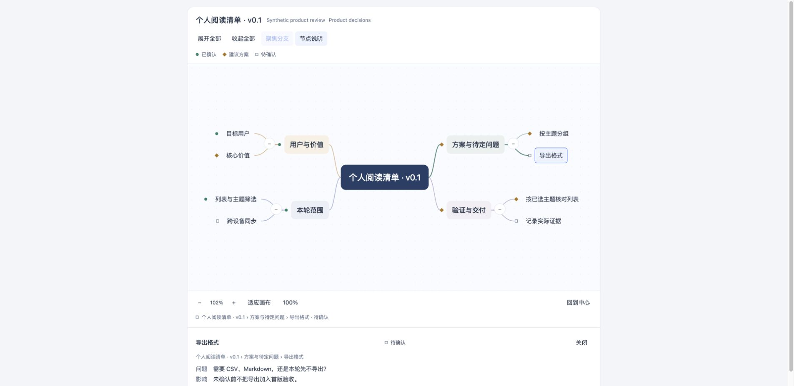

# Product Mindmap

**用交互式思维导图讲清产品讨论中的范围、方案和待定问题。**

A local interactive map for product decisions, explicit scope and unresolved questions.



## 先看一个例子

下载仓库后，用浏览器打开 [demo.html](demo.html)。这是完全虚构的“个人阅读清单”产品讨论：已明确的范围、建议方案和待确认问题分别显示，不把未确认项包装成决定。GitHub 文件页展示的是文件内容；本地浏览器打开 HTML 才是交互体验。

适合需求沟通、方案讲解、决策回顾和面向业务的技术表达。

## 可以做什么

- 展开、收起分支，点击节点查看细节。
- 在图中明确区分 `confirmed`、`suggested`、`pending`。
- 平移、缩放、居中，以及聚焦节点后还原视图。
- 从显式 JSON 生成单个可独立打开的 HTML，不需要账号或后台服务。

## 自己生成

Python 标准库即可；在仓库根目录运行：

```sh
python3 -B scripts/build_map.py examples/product-review.json demo.html --standalone
python3 -B scripts/build_map.py examples/product-review.json demo.html --standalone --check
python3 -B tests/test_build_map.py
```

[数据合同](references/data-contract.md)规定最多 200 节点、1–8 主分支和层级上限。示例 JSON 是可修改的起点，HTML 由当前模板与数据生成。

[验证记录](VERIFICATION.md)列出已执行的代码检查、桌面交互检查及其范围。

## 使用边界

这次提供的是独立工具版，不包含 Agent Skill 安装包或公司集成。节点状态来自输入作者的明确标注，渲染器不判定事实、审批或生产状态。示例中的 confirmed 只指合成案例设定，不代表真实业务审批。它不会自动读取会议记录、发现文件或调用模型，也不承诺截图导出、后台存储或完整可访问性认证。

## 许可状态

仓库暂不附加 MIT 等开源许可证；公开展示与后续开源授权分别处理。
